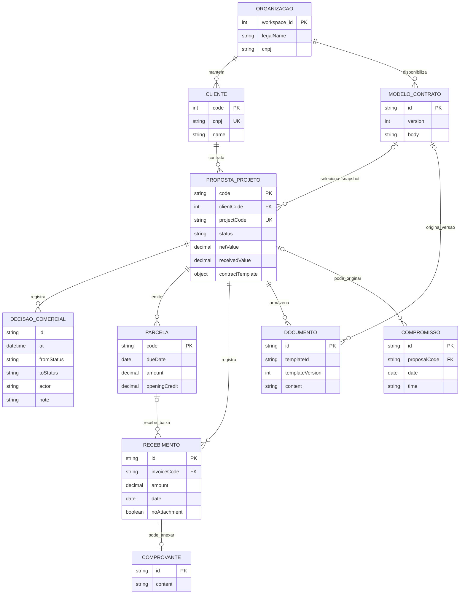
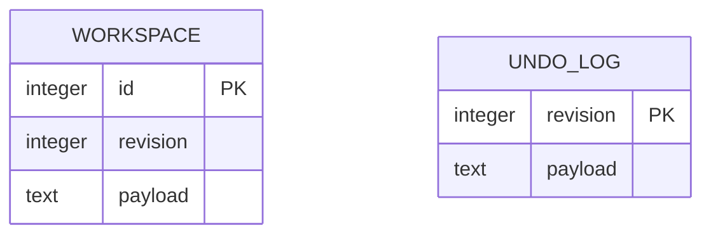
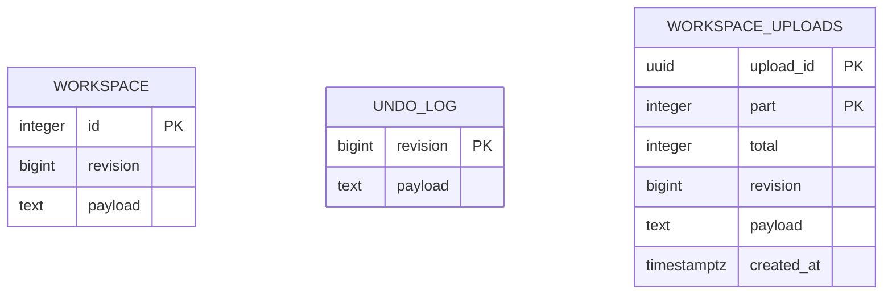

# Escopo desta edição
Esta pasta é a versão para GitHub/Vercel, separada do servidor Windows local. As seções históricas abaixo descrevem a evolução local. Para a implantação online, prevalece o suplemento de PostgreSQL ao final; o MER físico SQLite anterior permanece apenas como documentação da origem da migração.

# Documentação técnica: dicionário de dados e MER

Revisão: 18/11/2026. Escopo: implementação local OrionHUB em frontend JavaScript e API Python/SQLite.

## 1. Armazenamento e convenções

O SQLite não contém tabelas independentes de clientes ou contratos. O estado de negócio é um documento JSON armazenado em `workspace.payload`. O modelo lógico abaixo descreve as entidades desse JSON. As relações são verificadas pelo código, não por chaves estrangeiras SQL.

Datas de negócio: `YYYY-MM-DD`. Horários: `HH:mm`. Instantes de criação: ISO 8601. Valores monetários: números em BRL, com validação de precisão conforme a operação; a apresentação usa pt-BR. Anexos: base64 no JSON, sem endereço público separado. Identificadores de origem legada são preservados como referência.

### Modelo físico

| Tabela | Campo | Tipo | Regra / finalidade |
|---|---|---|---|
| workspace | id | INTEGER PK | Único workspace local, id = 1 |
| workspace | revision | INTEGER | Controle de concorrência, enviado em If-Match nos salvamentos |
| workspace | payload | TEXT JSON | Objeto com company, clients, proposals e events |
| undo_log | revision | INTEGER PK | Revisão de referência para reversão |
| undo_log | payload | TEXT JSON | Snapshot anterior; reversão é protegida contra alterações posteriores |

## 2. Dicionário de dados lógico

### Organização: `company`

| Campo | Tipo | Significado / regra |
|---|---|---|
| fantasyName / legalName | string | Nome fantasia e razão social |
| cnpj | string | Documento da organização, com apresentação textual |
| address | string | Endereço ou logradouro; registros antigos podem conter endereço completo |
| addressNumber / addressComplement | string opcional | Número e complemento |
| district / city / state / postalCode | string opcional | Bairro, município, UF de duas letras e CEP |
| contacts / contact / email / phone | string opcional | Contatos; contacts é o campo legado de contato combinado |
| stateRegistration / municipalRegistration | string opcional | Inscrições estadual e municipal |
| taxRegime | string opcional | simples, presumido, real ou mei; não calcula tributos |
| cnae / municipalCode / fiscalEmail | string opcional | CNAE, código IBGE e e-mail fiscal |
| branchName | string opcional | Referência cadastral da unidade |
| logoHeader | string opcional | Campo legado de identificação visual |
| contractTemplates | array de Modelo | Modelos vigentes da organização |

### Cliente: `clients[]`

| Campo | Tipo | Significado / regra |
|---|---|---|
| code | integer, identificador lógico | Único, sequencial, começa em 100 |
| name / legalName | string | Nome fantasia e razão social |
| cnpj | string | Documento validado e não repetido no cadastro |
| contact | string | Contato do cliente |
| address | string | Endereço do cliente |
| legacyCode | string/number opcional | Código anterior à migração |

### Orçamento/projeto: `proposals[]`

Uma contratação possui um único registro. Aprovação muda a leitura do protocolo para PJT; a emissão da ordem preenche projectCode e os campos operacionais. Não há duplicação de orçamento e projeto em tabelas diferentes.

| Campo | Tipo | Significado / regra |
|---|---|---|
| code | string, identificador lógico | ORC-YYYYMMDD-HHMMSScc; cc distingue centésimos |
| projectCode | string opcional, único | PJT com a mesma numeração de code; atribuído na emissão da ordem |
| legacyBudgetCode / legacyProjectCode | string opcional | Referências de migração |
| clientCode | integer, referência lógica | Identifica clients.code |
| client / legalName / clientCnpj / clientContact | string | Identificação copiada do cliente no registro comercial |
| campaign | string | Nome do projeto |
| netValue | number BRL | Valor contratado/orçado; positivo |
| receivedValue | number BRL | Recebido total, incluindo histórico e baixas |
| status | enum | Em negociação, Enviado, Aprovado, Recusado, Cancelado |
| responsible | string | Responsável operacional; não é FK para uma tabela de usuários |
| captureDate / deliveryDate | date opcional | Captação/início e entrega; entrega não anterior ao início |
| location / scopeItems | string opcional | Local e escopo |
| teamSize | number | Quantidade de pessoas |
| priority | string | Normal, Alta ou Urgente |
| paymentMethod | string | Pix, Transferência, Boleto, Cartão ou Outro |
| competencia | string opcional | Competência informada no orçamento |
| issuedAt / projectIssuedAt | datetime opcional | Instantes de emissão do orçamento e da ordem |
| erpStage | enum opcional | Planejamento, Em produção, Em revisão, Concluído |
| orderState | string opcional | Estado da ordem emitida, por exemplo Ativa |
| legalContractFile | string opcional | Nome/referência contratual legada; não garante existência do arquivo |
| snapshotCompany | object opcional | Cópia cadastral da organização na emissão; não replica a lista inteira de modelos |
| contractTemplateId | string opcional | Identificador do modelo selecionado |
| contractTemplate | Modelo opcional | Snapshot da versão explicitamente selecionada na negociação |
| documents | array de Anexo | Arquivo contratual e PDFs gerados |
| invoices | array de Parcela | Cobranças emitidas |
| receipts | array de Recebimento | Baixas registradas |

**Protocolo exibido:** ORC antes da aprovação; PJT depois da aprovação ou quando já existe ordem. O code interno continua estável. Cliente, valor e situação têm restrições de edição quando já existe ordem ou recebimento.

### Modelo: `company.contractTemplates[]` e snapshot em proposta

| Campo | Tipo | Significado / regra |
|---|---|---|
| id | UUID string | Identidade única do modelo |
| name | string até 120 | Nome apresentado na seleção |
| body | string até 60.000 | Texto com títulos ##, parágrafos e marcadores {{campo}} |
| version | integer >= 1 | Incrementada a cada edição |
| updatedAt | datetime | Última atualização |

Máximo de 200 modelos por organização. Importação TXT até 200 KB. Marcadores aceitos: cliente, cnpj_cliente, endereco_cliente, empresa, cnpj_empresa, endereco_empresa, projeto, protocolo, valor, entrega, escopo, pagamento, responsavel. Marcador desconhecido/incompleto ou dado necessário ausente impede emissão. Atualização do modelo não reescreve snapshots selecionados nem PDFs anteriores.

### Parcela: `proposals[].invoices[]`

| Campo | Tipo | Significado / regra |
|---|---|---|
| code | string | Identificador temporal da parcela, YYYYMMDD-HHMMSS |
| amount | number BRL | Valor emitido; soma das parcelas não supera netValue |
| dueDate | date | Vencimento |
| contractReference | string | Referência do contrato |
| supplierName / supplierDocument | string | Fornecedor e documento |
| openingCredit | number BRL | Crédito histórico alocado sem duplicar recebimentos |
| issuedAt | datetime | Emissão da parcela |

Saldo da parcela = amount - openingCredit - recebimentos vinculados. Saldo zero indica liquidação. Com saldo, vencimento anterior a hoje indica atraso; hoje ou depois indica a vencer.

### Recebimento: `proposals[].receipts[]`

| Campo | Tipo | Significado / regra |
|---|---|---|
| id | string | Identificador temporal da baixa |
| amount | number BRL | Positivo, não superior ao saldo disponível |
| date | date | Data real do pagamento, não futura |
| createdAt | datetime | Registro da baixa |
| invoiceCode | string ou null | Parcela vinculada; quando existem parcelas, deve ter saldo suficiente |
| noAttachment | boolean | Dispensa explícita de comprovante |
| attachment | Anexo ou null | Comprovante; obrigatório se não há dispensa |

Recebimentos históricos podem compor receivedValue sem existir em receipts. Não se cria uma baixa fictícia para compensar essa diferença.

### Anexo: documentos e comprovantes

| Campo | Tipo | Significado / regra |
|---|---|---|
| id | UUID string | Identificador do arquivo |
| name | string | Nome para consulta e download |
| type | MIME string | PDF, PNG ou JPG para anexos enviados |
| content | base64 string | Conteúdo efetivamente armazenado |
| uploadedAt | datetime | Registro do arquivo |
| templateId / templateVersion | string / integer opcionais | Origem de um PDF gerado por modelo |

Upload até 2 MB por anexo. Referência de nome sem content não permite download. Emissão por modelo cria novo PDF, não sobrescreve anexos anteriores e não representa assinatura.

### Compromisso: `events[]`

| Campo | Tipo | Significado / regra |
|---|---|---|
| id | UUID string ou legado | Identificador único |
| title / location | string | Atividade e local |
| date / time | date / time | Dia e horário |
| proposalCode | string opcional | Referência lógica para proposals.code |
| projectCode | string opcional | Referência operacional ou texto legado |
| type / reminders | string / array opcionais | Classificação e lembretes legados |
| googleEventId / targetCalendar | string opcional | Referências legadas; não implicam sincronização ativa |

Calendário permite 1, 3, 6 ou 12 meses consecutivos a partir do mês escolhido. Lista usa o mesmo período. O vínculo com projeto é opcional e registros legados podem conter referências textuais não resolvidas.

## 3. Campos calculados e apresentação

| Indicador | Definição |
|---|---|
| Contratado | Soma de netValue dos aprovados |
| Faturado | Soma de invoices.amount dos aprovados; não equivale à emissão fiscal externa |
| Recebido | Soma de receivedValue dos aprovados |
| Saldo pendente | Contratado menos recebido |
| A vencer | Saldos positivos de parcelas com vencimento >= hoje |
| Vencidas | Saldos positivos de parcelas com vencimento < hoje |
| Conversão | Quantidade aprovada / quantidade de orçamentos da base |
| Ticket médio | Contratado / quantidade aprovada |

Indicadores usam a emissão do orçamento como base de período. Valores recebidos agrupados por essa emissão não constituem extrato de caixa por data de pagamento. Gráficos ficam recolhidos até o clique e incluem detalhamento numérico e explicação da base.

## 4. Estado do navegador e dados derivados

- localStorage: preferências do menu, acessos recentes, tutoriais, estado lido/limpo/fixado das notificações, modo noite e foto de perfil local. Seletor de cor foi removido; paleta azul padrão.
- sessionStorage: páginas abertas, fixação/ordem das abas e estado de consulta por página, incluindo tags. Início e Acessos recentes não criam abas.
- Memória da página: filtros por bloco/coluna, mês e extensão do calendário, expansão dos gráficos. Não são registros financeiros.
- Notificações são calculadas das pendências; não há tabela Notification. Contador vermelho mostra a quantidade visível, com pulsação e alternativa estática para movimento reduzido. Popup de entrada removido.
- Busca e agrupamento alteram a visualização, não os registros. Dados de organização, cliente e endereço exibem cópia quando aplicável, sem conceder edição de campo protegido.

## 5. MER lógico

**Leitura e limites do MER:** PK/UK/FK representam identificadores e vínculos lógicos do documento JSON, não constraints SQL. Parcela e recebimento são subordinados à proposta; seus identificadores temporais são interpretados nesse contexto. Organização representa o único workspace local. Documento e Comprovante compartilham o tipo Anexo, mas têm donos diferentes. Modelo no cadastro guarda a versão vigente; proposta e documento guardam a versão selecionada/emitida, mesmo se o modelo for editado. Compromissos sem vínculo e referências legadas textuais permanecem possíveis. Não há entidade independente de projeto duplicando a proposta.

### MER físico SQLite

Não há FK física entre essas duas tabelas. A API associa revisões e snapshots na operação transacional de salvamento/reversão.

## 6. Regra de manutenção

A cada atualização, revisar impacto em campos, validações, relações, cálculos, persistência e ciclo de vida. Se houver mudança, atualizar este dicionário e o MER no mesmo pacote. Não apresentar uma relação planejada como constraint já implementada. Mudanças somente visuais devem ser registradas como sem impacto no modelo, após conferência.

## Revisão do catálogo inicial e notificações — 18/11/2026
O catálogo padrão contém 18 modelos-base em `defaultContractTemplates` no frontend: captação e edição, somente edição, roteiro/captação/edição, locação sem operação, somente captação e transmissão ao vivo; cada serviço possui variantes para empresa direta, agência intermediária e instituição cultural/terceiro setor. Não há seleção automática por inferência do perfil: o usuário escolhe o modelo na negociação ou na emissão.

Os modelos-base possuem os mesmos campos `id`, `name`, `body`, `version` e `updatedAt` do dicionário. Seus identificadores estáveis começam com `orion-base-`. São recursos incluídos no aplicativo, disponíveis mesmo em organizações sem modelos próprios. `contractTemplates()` combina esse catálogo com `company.contractTemplates`; um registro salvo de mesmo ID substitui a versão-base na seleção. Editar uma base cria uma personalização persistida com o mesmo ID e versão incrementada, sem duplicação. Os snapshots de propostas e documentos já emitidos permanecem preservados. Os modelos são textos-base para revisão das condições específicas; não pressupõem contratação pública nem dispensam validação do instrumento pelas partes.

O MER lógico permanece válido: modelo selecionado gera snapshot na proposta/documento. No modelo físico, somente personalizações e modelos próprios integram o JSON persistido; o catálogo-base é código distribuído, não uma nova tabela. Nenhum campo ou vínculo físico foi acrescentado nesta revisão.

O contador de notificações pulsa por quatro ciclos de 1,3 segundo apenas na primeira renderização com notificações após carregar o aplicativo. Depois permanece vermelho e estático. Navegação e atualização do contador não reiniciam a animação. Uma nova carga do aplicativo permite nova animação; usuários com redução de movimento recebem apenas o destaque estático. O sinalizador de início é somente memória, sem novo dado persistido.

Referência para a distinção entre prestação de serviços e locação de coisas: Código Civil, capítulos próprios, disponível em https://www2.camara.leg.br/legin/fed/lei/2002/lei-10406-10-janeiro-2002-432893-normaatualizada-pl.html . Não foram introduzidas multas ou cessões irrestritas automáticas nos modelos-base.

## Aprovação comercial — revisão de 18/11/2026
`Comercial > Pendentes de aprovação` é uma tela própria de fila e análise, não a tabela genérica de orçamentos. Inclui orçamentos Enviados ou Em negociação, sem ordem e sem recebimento, respeitando os filtros ativos. A análise reúne cliente, escopo, valor, datas, local, pagamento e modelo de contrato. É possível registrar aprovação, recusa ou retorno à negociação. A tela registra a confirmação comunicada pelo cliente, não assinatura eletrônica nem aprovação automática pelo cliente.

Novo campo opcional em `proposals[]`: `approvalHistory`, array ordenado cronologicamente de decisões. Cada item contém `id` (UUID da decisão), `at` (instante ISO do registro), `fromStatus` (situação anterior), `toStatus` (Aprovado, Recusado ou Em negociação), `actor` (nome de quem comunicou/confirmou, informado pelo operador; não representa identidade autenticada) e `note` (referência ou justificativa). O nome é obrigatório; motivo é obrigatório para recusa/negociação. O histórico novo não fabrica autoria/data para situações legadas.

A aprovação altera somente a situação e acrescenta uma decisão. Mantém o mesmo registro, protocolo numérico, cliente, valores, documentos, recebimentos e snapshots. A apresentação passa a PJT após aprovação, conforme regra existente; `projectCode` só é atribuído quando uma ordem é emitida. Aprovação comercial não emite ordem, parcela, nota fiscal nem registra pagamento. O aprovado sem ordem fica em Projetos e ordens > Aguardando emissão. O recusado permanece na carteira comercial e sai da fila. O retorno à negociação continua na fila. Decisões repetidas em registros já aprovados ou vinculados à execução/recebimento são bloqueadas nesta tela.

O MER lógico inclui PROPOSTA_PROJETO 1:N DECISAO_COMERCIAL. Fisicamente, o histórico permanece embutido no JSON da proposta em workspace.payload, sem nova tabela. O salvamento e o desfazer usam o controle de revisão existente. Nenhum registro real foi criado ou alterado para demonstração: a fila usa o orçamento enviado já existente do Castelo do Batel.

## Navegação canônica e módulo Aprovações — 18/11/2026
A rota `#pendentes` foi preservada para compatibilidade com abas, preferências e links anteriores, mas agora corresponde ao módulo independente **Aprovações**, abaixo de Kanban em Acesso rápido. Não pertence mais ao grupo Comercial. A fila e o histórico usam as mesmas propostas; nenhum registro é transferido, duplicado ou eliminado nessa reorganização.

Menu, título, abas, pesquisa e acessos recentes usam nomes canônicos: Início, Kanban (Quadro / Histórico), Aprovações, Clientes, Indicadores, Comercial (Orçamentos emitidos / Projetos e ordens), Contratos (Arquivo de documentos / Modelos de contrato), Faturamento, Agenda e Administração. Subpágina com nome igual ao módulo não gera caminho duplicado.

Botões de navegação no conteúdo mostram `Ir para <módulo > subpágina>`; cartões que apresentam uma métrica mantêm a descrição da métrica e exibem o destino explicitamente. A ação de consulta abre detalhes, a edição abre formulário e a emissão abre formulário de ordem; nenhuma delas é apresentada como mudança de módulo. `Registrar situação: Em negociação` salva uma decisão na mesma tela de Aprovações, enquanto `Ir para Comercial > Orçamentos emitidos` apenas navega. A decisão explica seu efeito antes do salvamento. Não há mudança em campos, relações MER, armazenamento ou protocolo por esta revisão; o dicionário permanece válido.

## Smartphones e rede local — 18/11/2026
Layout responsivo até 768 px: menu em gaveta com botão de abrir/fechar e fundo clicável; menu fecha ao navegar. Cabeçalho em duas linhas, abas com rolagem horizontal, tabelas com rolagem no próprio bloco, formulários em coluna única, Kanban com colunas deslizáveis e calendário mensal adaptado. Estado de abertura do menu é transitório no DOM e não altera o dicionário ou o MER. Preferências visuais continuam por navegador/dispositivo; os dados do workspace são compartilhados pela API. UUID usa getRandomValues quando randomUUID não existe em contexto HTTP de rede local.

`iniciar-rede-local.cmd` / `.ps1` inicia um segundo servidor na porta 8001, com `ORION_HOST=0.0.0.0`, usando a mesma base SQLite existente. O servidor local da porta 8000 não é encerrado. Para bind fora de loopback, o backend exige `ORION_LAN_PASSWORD` de pelo menos 16 caracteres. O launcher gera senha aleatória de 24 bytes e protege os recursos GET e gravações PUT com HTTP Basic (usuário orion). Esse usuário é uma credencial compartilhada de acesso, não identidade individual de auditoria. A verificação usa comparação em tempo constante e preserva as verificações de origem e revisão já existentes.

O endereço IPv4 privado e a senha são gravados exclusivamente em `ACESSO_CELULAR_LOCAL.txt`, excluído do ZIP. Variáveis com credenciais são removidas do processo iniciador depois da criação do filho. Não há senha em URLs. O celular precisa estar na mesma rede Wi-Fi, com o computador ligado e a porta permitida pela rede/firewall. Não há configuração automática de firewall ou encaminhamento no roteador. Este modo HTTP é destinado à rede local confiável; acesso pela internet exige uma implantação HTTPS com autenticação adequada. O IP pode mudar ao trocar de rede. Nenhuma entidade ou tabela foi acrescentada.

## Publicação GitHub/Vercel — revisão de 18/11/2026
A interface existente permanece; `api/index.py` passa a servir todos os recursos autenticados como uma Vercel Python Function. Não usa `ThreadingHTTPServer` na plataforma, não escuta portas e não grava em disco. O armazenamento passa a PostgreSQL externo, obrigatório, sem fallback para localStorage/seed quando a API falha. A base inicial vazia contém somente identificação genérica de organização. A instalação local e os anexos reais não foram alterados.

### Dicionário físico PostgreSQL
| Tabela | Campo | Tipo / regra |
|---|---|---|
| workspace | id | integer PK, check id=1 |
| workspace | revision | bigint não nulo; controle otimista If-Match |
| workspace | payload | text não nulo com JSON validado; até 16 milhões de bytes UTF-8 |
| undo_log | revision | bigint PK da revisão que pode ser desfeita |
| undo_log | payload | text não nulo, snapshot anterior |
| workspace_uploads | upload_id | UUID; PK composta com part; identificador transitório aleatório |
| workspace_uploads | part | integer, índice zero da parte |
| workspace_uploads | total | integer, quantidade esperada (1 a 128) |
| workspace_uploads | revision | bigint da revisão original do envio |
| workspace_uploads | payload | text, até 250 mil caracteres da serialização |
| workspace_uploads | created_at | timestamptz, default now(); expira em uma hora |

Payloads permanecem como texto JSON, não tabelas normalizadas para clientes, propostas e anexos. O MER lógico e o dicionário dos campos de negócio continuam válidos. A tabela temporária de upload não é um cadastro de documentos nem uma nova relação de cliente; ela armazena pedaços de uma única gravação em andamento.

As tabelas físicas não têm chaves estrangeiras entre si: as associações são operacionais por revisão. O commit bloqueia a linha workspace com SELECT FOR UPDATE, verifica a revisão, valida todo o JSON e as transições de negócio, grava snapshot para desfazer e a nova revisão na mesma transação. Partes incompletas ou obsoletas não substituem o workspace.

### Contratos da API
Todos os recursos exigem HTTP Basic sobre o domínio HTTPS. O usuário compartilhado vem de ORION_APP_USER e a senha, com no mínimo 32 caracteres, de ORION_APP_PASSWORD. Credenciais não são persistidas no JSON ou JavaScript e não constituem identidade individual de auditoria. DATABASE_URL permanece somente no servidor. O PostgreSQL é acessado com TLS obrigatório.

- GET /api/workspace: revisão e dados quando pequenos; revisão e quantidade de partes quando grandes.
- GET /api/workspace?part=N&revision=R: trecho da mesma revisão; 409 se já mudou.
- PUT /api/upload + If-Match: uploadId, part, total, text; até 2 milhões de bytes no envelope HTTP.
- PUT /api/commit + If-Match: uploadId; commit atômico após validar completude, tamanho e regras.
- PUT /api/workspace + If-Match: compatibilidade para pequenas gravações diretas.
- PUT /api/undo + If-Match: desfaz revisão disponível e devolve a nova revisão; cliente recarrega dados.
- GET /api/health: autenticação e leitura do banco verificadas.

O limite de 250 mil caracteres mantém cada resposta/requisição abaixo do limite de payload da plataforma mesmo com Unicode escapado; o frontend evita cortar pares substitutos UTF-16 ao enviar. A leitura usa substring no PostgreSQL para não trazer todos os anexos em cada parte. Há limite de 512 partes pendentes no conjunto do workspace e limpeza dos registros expirados na próxima etapa de envio.

### Migração e operação
scripts/migrate.py cria as três tabelas e insere somente quando workspace ainda não existe. --sqlite lê em modo somente leitura, preserva payload e revisão e aplica a normalização legada já existente. Não importa undo_log da origem. --empty cria instalação nova sem dados demonstrativos. A cópia original permanece intacta. Backups privados devem ficar fora do Git; o ZIP e o repositório não incluem dados reais, arquivos de acesso LAN ou variáveis reais de ambiente.

As configurações de Preview devem usar banco e credenciais separados de Production. CI verifica sintaxe, regras de negócio, autenticação, integridade do transporte e conflitos, com fixtures sintéticas. A homologação real de PostgreSQL e do deploy Vercel continua necessária após provisionar os recursos. Esta preparação não criou nem publicou serviços remotos.
